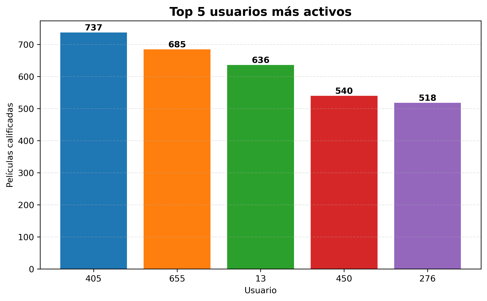
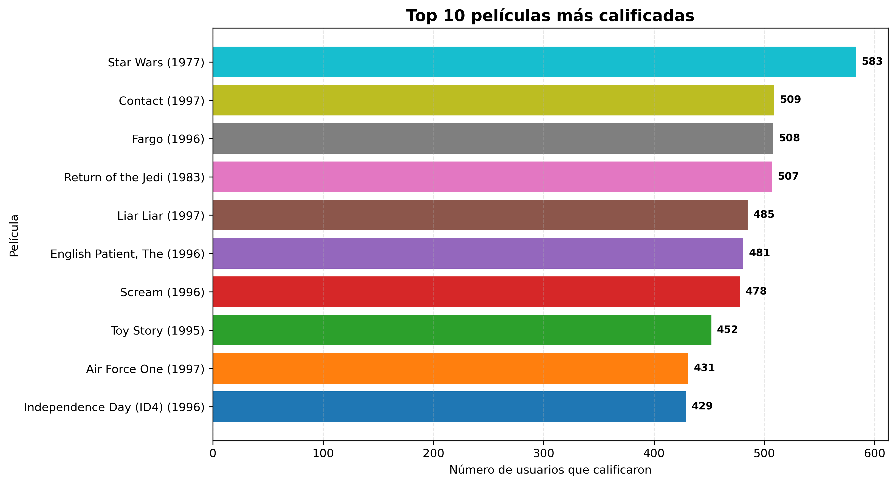
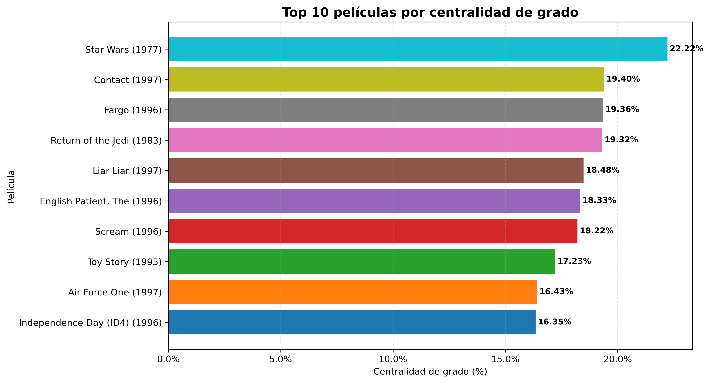
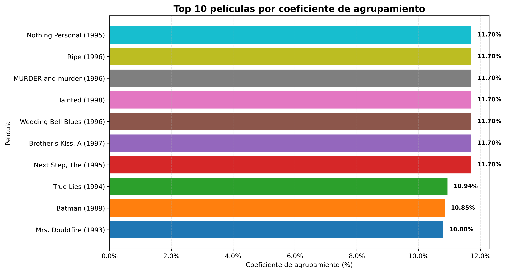
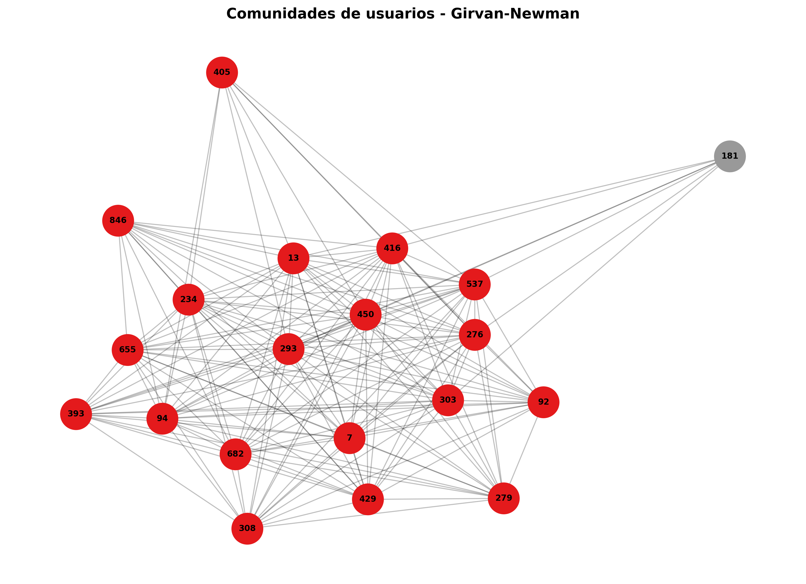
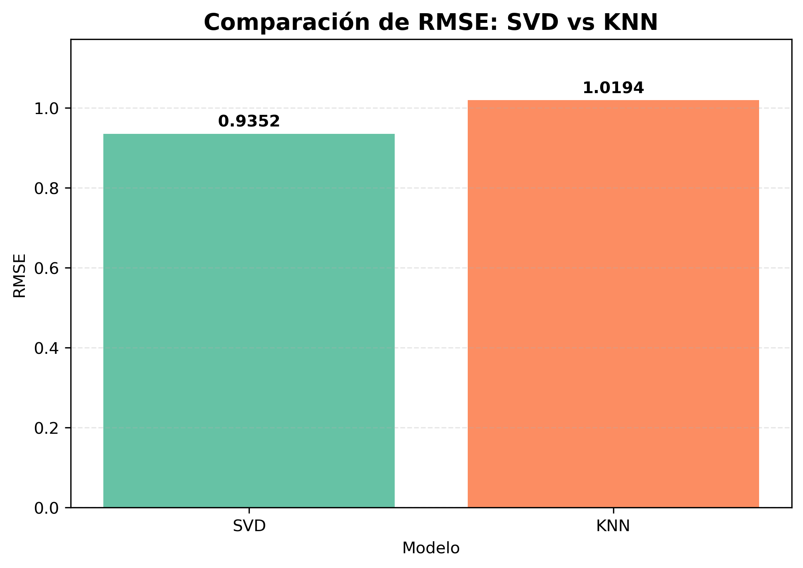
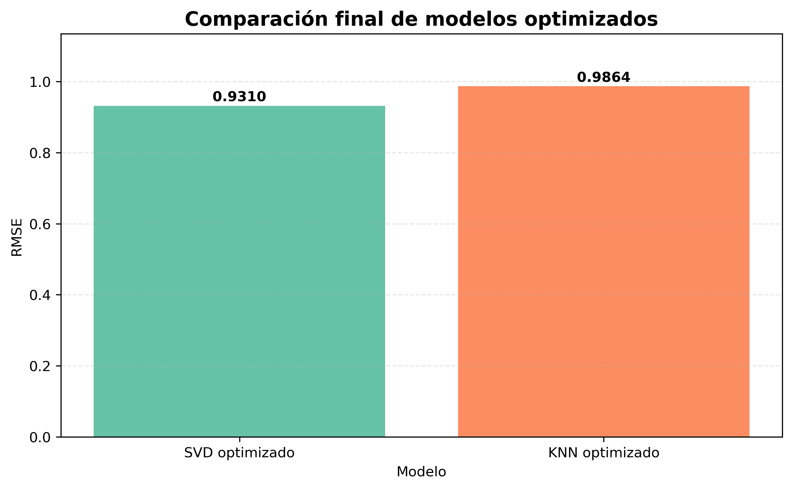
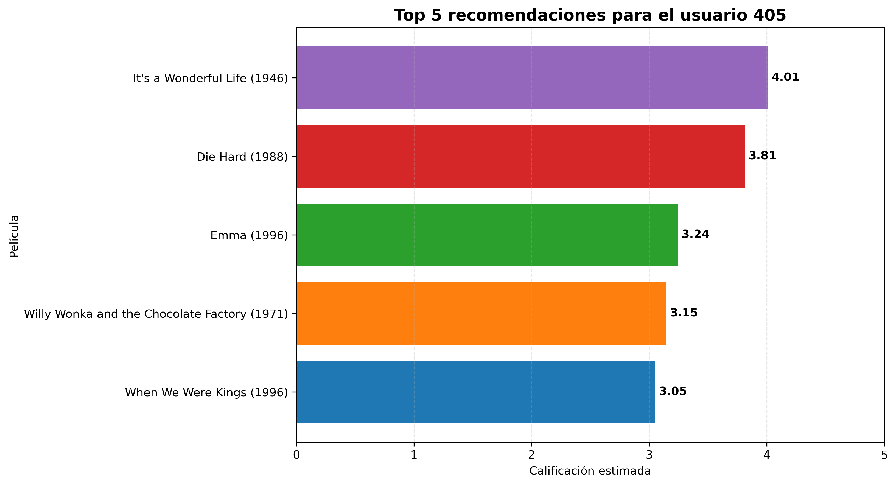

# Taller 03 - Análisis de Redes y Sistemas de Recomendación

## Maestría en Ciencia de Datos

Aplicación de técnicas de análisis de redes y sistemas de recomendación utilizando el conjunto de datos **MovieLens 100K**.

---

## Descripción del proyecto

Este proyecto tiene como finalidad analizar las interacciones entre usuarios y películas mediante teoría de grafos y construir sistemas de recomendación colaborativa.

El trabajo se divide en dos partes principales:

- análisis de redes con NetworkX;
- sistemas de recomendación con Surprise.

En la primera parte se construye un grafo bipartito entre usuarios y películas para identificar usuarios activos, películas centrales, coeficientes de agrupamiento y posibles comunidades.

En la segunda parte se implementan modelos de recomendación utilizando SVD y KNN, se comparan mediante RMSE, se ajustan hiperparámetros y se generan recomendaciones personalizadas.

---

## Objetivos

### Objetivo general

Aplicar técnicas de análisis de redes y sistemas de recomendación para estudiar las relaciones entre usuarios y películas y generar recomendaciones personalizadas.

### Objetivos específicos

- Construir un grafo bipartito usuario-película.
- Identificar usuarios con mayor actividad.
- Identificar películas con mayor centralidad.
- Analizar el coeficiente de agrupamiento.
- Aplicar técnicas de detección de comunidades.
- Visualizar la estructura de la red.
- Implementar modelos de recomendación SVD y KNN.
- Comparar el rendimiento mediante RMSE.
- Optimizar hiperparámetros.
- Generar recomendaciones personalizadas de películas.

---

## Dataset utilizado

### MovieLens 100K

El proyecto utiliza el conjunto de datos **MovieLens 100K**.

El dataset contiene:

- **100.000 calificaciones**
- **943 usuarios**
- **1.682 películas**
- Calificaciones entre **1 y 5**

Los principales archivos utilizados son:

- `u.data`: contiene las calificaciones realizadas por los usuarios.
- `u.item`: contiene la información y títulos de las películas.

---

## Herramientas utilizadas

| Herramienta | Aplicación |
|---|---|
| Python | Lenguaje principal del proyecto |
| Pandas | Manipulación de datos |
| NumPy | Operaciones numéricas |
| Matplotlib | Visualización de resultados |
| NetworkX | Construcción y análisis de grafos |
| Surprise | Sistemas de recomendación |
| Jupyter Notebook | Desarrollo del proyecto |

---

# Parte 1 - Análisis de Redes

## Construcción del grafo bipartito

Se construyó un grafo bipartito donde:

- los nodos de tipo usuario representan a los usuarios;
- los nodos de tipo película representan las películas;
- las aristas representan las calificaciones realizadas.

El grafo completo contiene:

- **2.625 nodos**
- **100.000 aristas**

---

## Usuarios más activos

Se identificaron los usuarios con mayor número de películas calificadas.

Los cinco usuarios más activos fueron:

| Usuario | Películas calificadas |
|---:|---:|
| 405 | 737 |
| 655 | 685 |
| 13 | 636 |
| 450 | 540 |
| 276 | 518 |

---

## Películas más centrales

Las películas con mayor número de usuarios que las calificaron fueron:

| Película | Usuarios |
|---|---:|
| Star Wars (1977) | 583 |
| Contact (1997) | 509 |
| Fargo (1996) | 508 |
| Return of the Jedi (1983) | 507 |
| Liar Liar (1997) | 485 |

La película **Star Wars (1977)** presentó la mayor centralidad dentro de la red analizada.

---

## Centralidad de grado

Se calculó la centralidad de grado normalizada para identificar las películas con mayor relevancia relativa dentro de la estructura de la red.

**Star Wars (1977)** obtuvo la mayor centralidad de grado, con aproximadamente **22,22%**.

---

## Coeficiente de agrupamiento

Se utilizó el coeficiente de agrupamiento específico para grafos bipartitos.

Esta métrica permite analizar el nivel de similitud entre las conexiones de los nodos de la red.

---

## Detección de comunidades

Se utilizó el algoritmo **Girvan-Newman** para explorar posibles comunidades.

Debido al tamaño del grafo completo, la detección de comunidades se realizó sobre una subred representativa.

La subred inicial utilizada contenía:

- 20 usuarios activos;
- 30 películas relevantes;
- 50 nodos;
- 497 aristas.

Los resultados mostraron que la red de usuarios activos presenta una estructura muy densa.

Girvan-Newman produjo divisiones poco equilibradas y modularidades negativas.

Como análisis complementario se utilizó **Greedy Modularity**, que identificó una única comunidad con modularidad igual a **0,0000**.

Esto indica que los usuarios seleccionados presentan patrones de interacción muy similares y no forman comunidades claramente diferenciadas.

---

# Parte 2 - Sistema de Recomendación

## Preparación de los datos

Las calificaciones fueron adaptadas al formato requerido por la librería Surprise.

El dataset fue dividido en:

- 80% para entrenamiento;
- 20% para prueba.

El conjunto de prueba estuvo compuesto por **20.000 calificaciones**.

---

## Modelo SVD

El modelo SVD obtuvo inicialmente:

**RMSE = 0,9352**

---

## Modelo KNN

El modelo KNN obtuvo inicialmente:

**RMSE = 1,0194**

Por lo tanto, SVD presentó un mejor desempeño inicial.

---

## Ajuste de hiperparámetros

### SVD optimizado

El ajuste mediante GridSearchCV permitió obtener:

**RMSE = 0,9310**

Los mejores hiperparámetros fueron:

- `n_factors = 50`
- `n_epochs = 20`
- `lr_all = 0.01`
- `reg_all = 0.05`

### KNN optimizado

El modelo KNN optimizado obtuvo:

**RMSE = 0,9864**

La mejor configuración fue:

- `k = 40`
- similitud = `msd`
- `user_based = False`

---

## Comparación final

| Modelo | RMSE |
|---|---:|
| SVD optimizado | 0,9310 |
| KNN optimizado | 0,9864 |

El modelo **SVD optimizado** presentó el menor error y fue seleccionado como modelo final.

---

## Recomendaciones personalizadas

Para demostrar el funcionamiento del sistema se utilizó el usuario **405**.

Las cinco principales recomendaciones generadas fueron:

| Película | Calificación estimada |
|---|---:|
| It's a Wonderful Life (1946) | 4,01 |
| Die Hard (1988) | 3,81 |
| Emma (1996) | 3,24 |
| Willy Wonka and the Chocolate Factory (1971) | 3,15 |
| When We Were Kings (1996) | 3,05 |

---

# Visualizaciones generadas

## 1. Usuarios más activos



---

## 2. Películas más centrales



---

## 3. Centralidad de grado



---

## 4. Coeficiente de agrupamiento



---

## 5. Comunidades de usuarios



---

## 6. Comparación SVD vs KNN



---

## 7. Comparación de modelos optimizados



---

## 8. Recomendaciones para el usuario 405



---

## Principales resultados

- El grafo completo contiene **2.625 nodos** y **100.000 aristas**.
- El usuario más activo fue el usuario **405**, con **737 películas calificadas**.
- **Star Wars (1977)** fue la película con mayor número de conexiones.
- La subred analizada no presentó comunidades claramente diferenciadas.
- SVD obtuvo mejor desempeño que KNN.
- El mejor RMSE fue de aproximadamente **0,9310**.
- El sistema generó recomendaciones personalizadas para el usuario 405.

---

## Estructura del repositorio

```text
Taller_03_Ciencia_Datos/
│
├── Taller_03_Ciencia_Datos.ipynb
├── README.md
├── ml-100k/
├── top_5_usuarios_activos.png
├── top_10_peliculas_centrales.png
├── centralidad_grado_peliculas.png
├── coeficiente_agrupamiento_peliculas.png
├── comunidades_girvan_newman.png
├── comparacion_rmse_svd_knn.png
├── comparacion_modelos_optimizados.png
└── top_5_recomendaciones_usuario_405.png
```

---

## Conclusiones

El desarrollo del Taller 03 permitió aplicar técnicas de análisis de redes y sistemas de recomendación sobre el conjunto de datos MovieLens 100K.

El análisis de redes permitió representar las interacciones entre usuarios y películas mediante un grafo bipartito, identificar usuarios activos, películas centrales y analizar la estructura de conexiones.

Los métodos de detección de comunidades mostraron que la subred de usuarios más activos presenta una estructura altamente conectada, sin comunidades claramente diferenciadas.

En la segunda parte se implementaron modelos SVD y KNN para estimar calificaciones de películas.

El modelo SVD optimizado obtuvo el mejor rendimiento, con un RMSE aproximado de **0,9310**, superando al modelo KNN optimizado.

Finalmente, el modelo seleccionado permitió generar recomendaciones personalizadas para un usuario específico, demostrando la utilidad de los sistemas de recomendación basados en filtrado colaborativo.

---

## Ejecución del proyecto

Para ejecutar el proyecto se requiere Python y las siguientes librerías:

```text
pandas
numpy
matplotlib
networkx
scikit-surprise
```

El análisis puede ejecutarse desde Jupyter Notebook abriendo:

```text
Taller_03_Ciencia_Datos.ipynb
```

Las celdas deben ejecutarse en orden desde el inicio hasta el final.